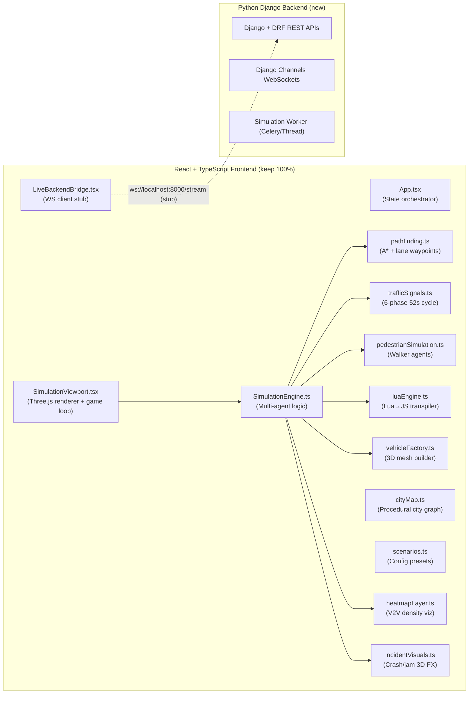
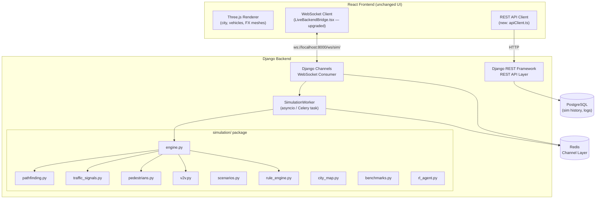
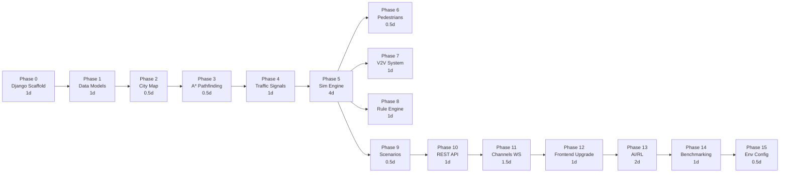

# AMAPP → Django Backend Migration Plan
**Adaptive Multi-Agent Pathfinding & Priority (AMAPP) — TypeScript → Python/Django Refactor**

> [!IMPORTANT]
> **Goal:** Migrate all simulation logic, pathfinding, agents, signals, V2V, AI/RL, scenarios, and benchmarking to a Python/Django + DRF backend with Django Channels WebSockets. The React + Three.js frontend is preserved entirely; only the data-source changes from embedded TS classes to backend API/WS streams.

---

## Repository Audit Summary

### Current Architecture



### Files to Migrate (Simulation Logic)

| File | LOC | Purpose | Migration Target |
|------|-----|---------|-----------------|
| `simulationEngine.ts` | ~1100 | Core tick loop, vehicle physics, V2V, incidents | `simulation/engine.py` |
| `pathfinding.ts` | ~160 | A* + congestion weights + lane waypoints | `simulation/pathfinding.py` |
| `trafficSignals.ts` | ~550 | 52s 6-phase cycle, preemption, sensors | `simulation/traffic_signals.py` |
| `pedestrianSimulation.ts` | ~130 | Walker spawn, crosswalk crossing | `simulation/pedestrians.py` |
| `cityMap.ts` | ~440 | Graph nodes/roads (data only, not Three.js) | `simulation/city_map.py` |
| `scenarios.ts` | ~180 | Scenario presets/configs | `simulation/scenarios.py` |
| `luaEngine.ts` | ~270 | Script interpreter | `simulation/rule_engine.py` (Python) |
| `vehicleFactory.ts` | ~400 | Mesh builder | **KEEP in frontend** (Three.js only) |
| `heatmapLayer.ts` | ~100 | V2V density heatmap | **KEEP in frontend** (Three.js viz) |
| `incidentVisuals.ts` | ~300 | 3D crash/jam FX | **KEEP in frontend** (Three.js viz) |
| `types/simulation.ts` | ~180 | TypeScript interfaces | Python `dataclasses` / DRF Serializers |
| `LiveBackendBridge.tsx` | ~100 | WS stub (already exists) | **Upgrade** to full WS consumer |

### Files to Keep Entirely in Frontend (No Migration)

- `SimulationViewport.tsx` — Three.js renderer, camera, lighting
- `vehicleFactory.ts` — Three.js mesh geometry only
- `heatmapLayer.ts` — Three.js material/geometry visualization
- `incidentVisuals.ts` — Three.js particle FX
- `cityMap.ts` (Three.js rendering half) — road/building meshes
- All UI components: `ControlOverlay`, `MinimalHUD`, `AnalyticsPanel`, `LuaScriptDrawer`, `VehicleInspectorPopup`, `OverheadV2VBubbles`

---

## Target Architecture



---

## Phase-by-Phase Migration Plan

### Phase 0 — Django Project Scaffold

**Duration:** ~1 day | **Risk:** Low

Create the Django project structure alongside the existing frontend:

```
Adaptive-MAPPAV/
├── backend/                    ← NEW Django project root
│   ├── manage.py
│   ├── backend/
│   │   ├── settings.py
│   │   ├── urls.py
│   │   ├── asgi.py             ← Django Channels entry point
│   │   └── wsgi.py
│   ├── simulation/             ← Main simulation Django app
│   │   ├── models.py
│   │   ├── serializers.py
│   │   ├── views.py
│   │   ├── consumers.py        ← Channels WebSocket consumer
│   │   ├── routing.py
│   │   ├── urls.py
│   │   ├── engine.py
│   │   ├── pathfinding.py
│   │   ├── traffic_signals.py
│   │   ├── pedestrians.py
│   │   ├── v2v.py
│   │   ├── city_map.py
│   │   ├── scenarios.py
│   │   ├── rule_engine.py
│   │   ├── benchmarks.py
│   │   └── rl_agent.py
│   ├── requirements.txt
│   └── Dockerfile
├── src/                        ← Existing frontend (unchanged structure)
└── package.json
```

**Dependencies:**
```
django>=5.1
djangorestframework>=3.15
channels>=4.1
channels-redis>=4.2
daphne>=4.1
celery>=5.4
redis>=5.0
psycopg2-binary>=2.9
numpy>=2.0
networkx>=3.3
```

**Tasks:**
- [ ] `django-admin startproject backend`
- [ ] `python manage.py startapp simulation`
- [ ] Configure `INSTALLED_APPS`, `CHANNEL_LAYERS` (Redis), `DATABASES`
- [ ] Setup `asgi.py` with `ProtocolTypeRouter`
- [ ] Add `CORS_ALLOWED_ORIGINS` for `http://localhost:3000`
- [ ] Create `requirements.txt`

---

### Phase 1 — Data Models & Type System

**Duration:** ~1 day | **Risk:** Low

Translate `src/types/simulation.ts` to Python dataclasses and Django models.

#### 1a. Python Dataclasses (in-memory simulation state)

**File:** `backend/simulation/types.py`

```python
# Mirrors simulation.ts interfaces exactly
from dataclasses import dataclass, field
from typing import Literal, Optional
import time

VehicleType = Literal['sedan','suv','truck','taxi','emergency',
                      'police','ambulance','fire_engine','vip_limo']
VehicleStatus = Literal['cruising','braking','rerouting','yielding','stopped']
SignalColor = Literal['green','yellow','red']

@dataclass
class Vector2D:
    x: float
    z: float

@dataclass
class MapNode:
    id: str
    x: float
    z: float
    type: Literal['intersection','curve','terminal']
    connected_node_ids: list[str]
    traffic_light: Optional['IntersectionTrafficLight'] = None

@dataclass
class RoadSegment:
    id: str
    from_node_id: str
    to_node_id: str
    lanes: int
    length: float
    speed_limit: float
    capacity: int
    current_vehicle_count: int = 0
    is_blocked: bool = False

@dataclass
class VehicleAgent:
    id: str
    type: VehicleType
    x: float
    z: float
    heading: float          # radians
    speed: float            # m/s
    target_speed: float
    max_speed: float
    status: VehicleStatus = 'cruising'
    priority: int = 3
    color: str = '#0284c7'
    current_node_id: str = ''
    target_node_id: str = ''
    path: list[Vector2D] = field(default_factory=list)
    path_node_ids: list[str] = field(default_factory=list)
    path_index: int = 0
    v2v_neighbors: list[str] = field(default_factory=list)
    avoidance_radius: float = 7.0
    reroute_count: int = 0
    path_efficiency: float = 100.0
    active_lua_rule: str = ''
    lateral_offset: float = 0.0
    target_lateral_offset: float = 0.0
    is_yielding_to_emergency: bool = False
    # ... (all fields from VehicleAgent interface)
```

#### 1b. Django ORM Models (persistence)

**File:** `backend/simulation/models.py`

```python
from django.db import models

class SimulationRun(models.Model):
    scenario = models.CharField(max_length=50)
    started_at = models.DateTimeField(auto_now_add=True)
    ended_at = models.DateTimeField(null=True)
    total_vehicles = models.IntegerField(default=0)
    completed_trips = models.IntegerField(default=0)
    total_reroutes = models.IntegerField(default=0)

class MetricsSnapshot(models.Model):
    run = models.ForeignKey(SimulationRun, on_delete=models.CASCADE, related_name='snapshots')
    sim_time = models.FloatField()
    throughput_per_min = models.FloatField()
    avg_speed_kmh = models.FloatField()
    avg_delay_seconds = models.FloatField()
    v2v_packets_per_sec = models.FloatField()
    collision_risk_index = models.FloatField()
    active_vehicles = models.IntegerField()
    recorded_at = models.DateTimeField(auto_now_add=True)

class VehicleLog(models.Model):
    run = models.ForeignKey(SimulationRun, on_delete=models.CASCADE)
    vehicle_id = models.CharField(max_length=20)
    vehicle_type = models.CharField(max_length=20)
    reroute_count = models.IntegerField()
    path_efficiency = models.FloatField()
    final_status = models.CharField(max_length=20)
```

#### 1c. DRF Serializers

**File:** `backend/simulation/serializers.py`

```python
from rest_framework import serializers
from .models import SimulationRun, MetricsSnapshot

class VehicleStateSerializer(serializers.Serializer):
    id = serializers.CharField()
    type = serializers.CharField()
    x = serializers.FloatField()
    z = serializers.FloatField()
    heading = serializers.FloatField()
    speed = serializers.FloatField()
    status = serializers.CharField()
    color = serializers.CharField()
    priority = serializers.IntegerField()
    lateral_offset = serializers.FloatField()

class IncidentSerializer(serializers.Serializer):
    id = serializers.CharField()
    type = serializers.CharField()
    x = serializers.FloatField()
    z = serializers.FloatField()
    radius = serializers.FloatField()
    label = serializers.CharField()

class SimulationStateSerializer(serializers.Serializer):
    vehicles = VehicleStateSerializer(many=True)
    incidents = IncidentSerializer(many=True)
    metrics = serializers.DictField()
    traffic_lights = serializers.DictField()
    v2v_links = serializers.ListField()
    v2v_bubbles = serializers.ListField()
    pedestrians = serializers.ListField()
    sim_time = serializers.FloatField()
```

**Frontend adaptation:** No changes to component files; `LiveBackendBridge.tsx` already handles JSON parsing.

---

### Phase 2 — City Map Graph

**Duration:** ~0.5 day | **Risk:** Low

Migrate the **data/graph half** of `cityMap.ts` (not the Three.js rendering half).

**File:** `backend/simulation/city_map.py`

```python
import math
from .types import MapNode, RoadSegment, Vector2D, IntersectionTrafficLight
from typing import Dict

GRID_SIZE = 5          # 5x5 grid → 25 intersections
SPACING = 75.0         # meters between intersections
ROAD_WIDTH = 14.0

class CityLayout:
    def __init__(self):
        self.nodes: Dict[str, MapNode] = {}
        self.roads: Dict[str, RoadSegment] = {}
        self.intersections: list[Vector2D] = []
        self.bounds = {}
        self._build_grid()

    def _build_grid(self):
        """Replicates the 5×5 intersection grid from cityMap.ts"""
        grid_size = GRID_SIZE
        spacing = SPACING

        # Create intersection nodes
        for gx in range(grid_size):
            for gz in range(grid_size):
                cx = (gx - (grid_size - 1) / 2) * spacing
                cz = (gz - (grid_size - 1) / 2) * spacing
                node_id = f"n_{gx}_{gz}"
                # Initialize 52s traffic light
                tl = IntersectionTrafficLight(
                    ns_state='green', ew_state='red',
                    timer=0.0, cycle_duration=52.0,
                    phase_index=1,
                    phase_name='North-South Green',
                    phase_time_remaining=20.0,
                    emergency_override_axis=None,
                    emergency_override_timer=0.0,
                )
                self.nodes[node_id] = MapNode(
                    id=node_id, x=cx, z=cz,
                    type='intersection',
                    connected_node_ids=[],
                    traffic_light=tl,
                )
                self.intersections.append(Vector2D(x=cx, z=cz))

        # Create bidirectional road segments
        for gx in range(grid_size):
            for gz in range(grid_size):
                nid = f"n_{gx}_{gz}"
                node = self.nodes[nid]
                for dx, dz in [(1,0),(-1,0),(0,1),(0,-1)]:
                    nx, nz = gx+dx, gz+dz
                    if 0 <= nx < grid_size and 0 <= nz < grid_size:
                        nid2 = f"n_{nx}_{nz}"
                        node.connected_node_ids.append(nid2)
                        road_key = f"road_{nid}_{nid2}"
                        n2 = self.nodes[nid2]
                        dist = math.sqrt((node.x-n2.x)**2 + (node.z-n2.z)**2)
                        self.roads[road_key] = RoadSegment(
                            id=road_key, from_node_id=nid, to_node_id=nid2,
                            lanes=3, length=dist, speed_limit=50/3.6,
                            capacity=20, current_vehicle_count=0,
                        )
```

> [!NOTE]
> The Three.js visual rendering in `cityMap.ts` (ground mesh, building geometry, road textures, streetlights) stays entirely in the frontend. The backend only produces the **pure graph data** (nodes, edges, adjacency). The frontend serializes this once on startup via a REST call.

**New REST endpoint:** `GET /api/city/` → returns `{ nodes: [...], roads: [...], bounds: {...} }`

---

### Phase 3 — A* Pathfinding

**Duration:** ~0.5 day | **Risk:** Low

Direct port of `pathfinding.ts` — the algorithm is pure math.

**File:** `backend/simulation/pathfinding.py`

```python
import math
from dataclasses import dataclass, field
from typing import Optional
from .types import Vector2D, CityLayout, Incident

@dataclass
class AStarNode:
    id: str
    g_score: float = 0.0
    f_score: float = 0.0
    parent: Optional['AStarNode'] = None

def distance_2d(a: Vector2D, b: Vector2D) -> float:
    return math.sqrt((a.x - b.x)**2 + (a.z - b.z)**2)

def dist_to_segment(p: Vector2D, a: Vector2D, b: Vector2D) -> float:
    l2 = (b.x-a.x)**2 + (b.z-a.z)**2
    if l2 == 0:
        return distance_2d(p, a)
    t = max(0, min(1, ((p.x-a.x)*(b.x-a.x) + (p.z-a.z)*(b.z-a.z)) / l2))
    return distance_2d(p, Vector2D(a.x + t*(b.x-a.x), a.z + t*(b.z-a.z)))

def is_road_segment_blocked(from_id, to_id, city, incidents: list[Incident]) -> bool:
    frm = city.nodes.get(from_id)
    to = city.nodes.get(to_id)
    if not frm or not to: return False
    for inc in incidents:
        if inc.type == 'traffic_jam': continue
        d = dist_to_segment(Vector2D(inc.x, inc.z),
                            Vector2D(frm.x, frm.z),
                            Vector2D(to.x, to.z))
        if d < inc.radius + 3.0:
            return True
    return False

def find_path(start_id, target_id, city, incidents, avoid_incidents=True):
    """A* with congestion weights and right-hand lane offset waypoints."""
    if start_id == target_id: return None
    start_node = city.nodes.get(start_id)
    target_node = city.nodes.get(target_id)
    if not start_node or not target_node: return None

    open_set: dict[str, AStarNode] = {}
    closed_set: set[str] = set()
    start = AStarNode(id=start_id, g_score=0.0,
                      f_score=distance_2d(Vector2D(start_node.x, start_node.z),
                                          Vector2D(target_node.x, target_node.z)))
    open_set[start_id] = start

    while open_set:
        current = min(open_set.values(), key=lambda n: n.f_score)
        if current.id == target_id:
            # Reconstruct path
            path_ids = []
            c = current
            while c:
                path_ids.insert(0, c.id)
                c = c.parent
            waypoints = _generate_lane_waypoints(path_ids, city)
            return {'path_points': waypoints, 'path_node_ids': path_ids}

        open_set.pop(current.id)
        closed_set.add(current.id)

        cur_node = city.nodes[current.id]
        for nbr_id in cur_node.connected_node_ids:
            if nbr_id in closed_set: continue
            nbr_node = city.nodes.get(nbr_id)
            if not nbr_node: continue

            penalty = 10000.0 if (avoid_incidents and
                is_road_segment_blocked(current.id, nbr_id, city, incidents)) else 1.0
            road_key = f"road_{current.id}_{nbr_id}"
            road = city.roads.get(road_key)
            cong = 1 + road.current_vehicle_count * 0.15 if road else 1.0
            edge_cost = distance_2d(Vector2D(cur_node.x, cur_node.z),
                                    Vector2D(nbr_node.x, nbr_node.z)) * penalty * cong
            tg = current.g_score + edge_cost

            if nbr_id not in open_set or tg < open_set[nbr_id].g_score:
                open_set[nbr_id] = AStarNode(
                    id=nbr_id, g_score=tg,
                    f_score=tg + distance_2d(Vector2D(nbr_node.x, nbr_node.z),
                                             Vector2D(target_node.x, target_node.z)),
                    parent=current)
    return None

def _generate_lane_waypoints(node_ids, city) -> list[dict]:
    """Right-hand drive 3.2m lane offset with corner bevels."""
    waypoints = []
    lane_offset = 3.2
    for i in range(len(node_ids)):
        cur = city.nodes[node_ids[i]]
        if i < len(node_ids) - 1:
            nxt = city.nodes[node_ids[i+1]]
            dx = nxt.x - cur.x; dz = nxt.z - cur.z
            ln = math.sqrt(dx*dx + dz*dz) or 1
            nx = -dz/ln; nz = dx/ln
            waypoints.append({'x': cur.x + nx*lane_offset, 'z': cur.z + nz*lane_offset})
            waypoints.append({'x': (cur.x+nxt.x)/2 + nx*lane_offset, 'z': (cur.z+nxt.z)/2 + nz*lane_offset})
            waypoints.append({'x': nxt.x - (dx/ln)*4 + nx*lane_offset, 'z': nxt.z - (dz/ln)*4 + nz*lane_offset})
        else:
            waypoints.append({'x': cur.x, 'z': cur.z})
    return waypoints
```

---

### Phase 4 — Traffic Signal Manager

**Duration:** ~1 day | **Risk:** Medium

Port `trafficSignals.ts` — pure state machine logic (no Three.js materials, those stay in frontend).

**File:** `backend/simulation/traffic_signals.py`

```python
STRICT_CYCLE = 52.0
PHASE_NS_GREEN = 20.0; PHASE_NS_YELLOW = 4.0; PHASE_NS_ALL_RED = 2.0
PHASE_EW_GREEN = 20.0; PHASE_EW_YELLOW = 4.0; PHASE_EW_ALL_RED = 2.0
HALF_CYCLE = 26.0

class TrafficSignalManager:
    def __init__(self, city):
        self.city = city
        self.total_preemptions = 0

    @staticmethod
    def evaluate_cycle_phase(timer: float) -> dict:
        """Exact 6-phase 52s cycle — mirrors TrafficSignalManager.evaluateCyclePhase()"""
        t = timer % STRICT_CYCLE
        if t < PHASE_NS_GREEN:
            return {'ns': 'green', 'ew': 'red', 'phase_index': 1,
                    'phase_name': 'North-South Green',
                    'phase_remaining': round(PHASE_NS_GREEN - t, 1)}
        elif t < PHASE_NS_GREEN + PHASE_NS_YELLOW:
            return {'ns': 'yellow', 'ew': 'red', 'phase_index': 2,
                    'phase_name': 'North-South Yellow Caution',
                    'phase_remaining': round(PHASE_NS_GREEN + PHASE_NS_YELLOW - t, 1)}
        elif t < HALF_CYCLE:
            return {'ns': 'red', 'ew': 'red', 'phase_index': 3,
                    'phase_name': 'All-Red Clearance Hold',
                    'phase_remaining': round(HALF_CYCLE - t, 1)}
        elif t < HALF_CYCLE + PHASE_EW_GREEN:
            return {'ns': 'red', 'ew': 'green', 'phase_index': 4,
                    'phase_name': 'East-West Green',
                    'phase_remaining': round(HALF_CYCLE + PHASE_EW_GREEN - t, 1)}
        elif t < HALF_CYCLE + PHASE_EW_GREEN + PHASE_EW_YELLOW:
            return {'ns': 'red', 'ew': 'yellow', 'phase_index': 5,
                    'phase_name': 'East-West Yellow Caution',
                    'phase_remaining': round(HALF_CYCLE + PHASE_EW_GREEN + PHASE_EW_YELLOW - t, 1)}
        else:
            return {'ns': 'red', 'ew': 'red', 'phase_index': 6,
                    'phase_name': 'All-Red Clearance Hold (EW Transition)',
                    'phase_remaining': round(STRICT_CYCLE - t, 1)}

    def update(self, dt: float):
        for node in self.city.nodes.values():
            tl = node.traffic_light
            if not tl: continue
            if tl.emergency_override_axis:
                tl.emergency_override_timer -= dt
                if tl.emergency_override_timer <= 0:
                    tl.emergency_override_axis = None
            else:
                tl.timer = (tl.timer + dt) % STRICT_CYCLE
                phase = self.evaluate_cycle_phase(tl.timer)
                tl.ns_state = phase['ns']
                tl.ew_state = phase['ew']
                tl.phase_index = phase['phase_index']
                tl.phase_name = phase['phase_name']
                tl.phase_time_remaining = phase['phase_remaining']

    def request_emergency_preemption(self, node_id: str, axis: str, duration=7.0):
        node = self.city.nodes.get(node_id)
        if not node or not node.traffic_light: return
        tl = node.traffic_light
        if tl.emergency_override_axis and tl.emergency_override_axis != axis and tl.emergency_override_timer > 2.5:
            return
        if not tl.emergency_override_axis:
            self.total_preemptions += 1
        tl.emergency_override_axis = axis
        tl.emergency_override_timer = duration

    def is_signal_red_for_vehicle(self, node_id: str, heading: float) -> bool:
        node = self.city.nodes.get(node_id)
        if not node or not node.traffic_light: return False
        import math
        axis = 'ns' if abs(math.cos(heading)) > 0.707 else 'ew'
        state = node.traffic_light.ns_state if axis == 'ns' else node.traffic_light.ew_state
        return state in ('red', 'yellow')
```

---

### Phase 5 — Vehicle Agents & Simulation Engine

**Duration:** ~3–4 days | **Risk:** High (core logic)

This is the largest migration: `simulationEngine.ts` (~1100 lines) → `engine.py`.

**File:** `backend/simulation/engine.py`

Key subsystems to migrate:
1. **Vehicle spawning** — `spawnRandomVehicle()` with typed spawn rates
2. **Physics tick** — `updateVehicle()`: steering, acceleration, lateral offset, siren behavior
3. **Collision avoidance** — forward cone detection, emergency corridor clearance
4. **Intersection logic** — box avoidance, gridlock hold, stop bar yield
5. **V2V communication** — packet emission, jam cascade, emergency broadcast
6. **Emergency priority** — green wave cascade, corridor clearance (`lateralOffset = +2.4m`)
7. **Incident detection** — zone proximity, rerouting trigger
8. **Metrics computation** — throughput, avg speed, collision risk index, preemption rates

```python
import math, random, time, uuid
from typing import Optional
from .types import VehicleAgent, Incident, V2VLink, SimulationMetrics
from .pathfinding import find_path, distance_2d
from .traffic_signals import TrafficSignalManager
from .pedestrians import PedestrianManager
from .scenarios import SCENARIOS
from .city_map import CityLayout
from .v2v import V2VManager
from .rule_engine import RuleEngine

EMERGENCY_TYPES = {'police', 'ambulance', 'fire_engine', 'emergency', 'vip_limo'}

class SimulationEngine:
    def __init__(self, city: CityLayout):
        self.city = city
        self.vehicles: list[VehicleAgent] = []
        self.incidents: list[Incident] = []
        self.v2v_links: list[V2VLink] = []
        self.v2v_bubbles: list = []
        self.metrics = SimulationMetrics(...)
        self.metrics_history: list[dict] = []
        self.current_scenario = 'police_pursuit'
        self.signal_manager = TrafficSignalManager(city)
        self.pedestrian_manager = PedestrianManager(city, 32)
        self.v2v_manager = V2VManager()
        self.rule_engine = RuleEngine()
        self.node_ids = list(city.nodes.keys())
        self.sim_time = 0.0
        self._load_scenario('police_pursuit')

    def tick(self, dt: float):
        """Main simulation step — called at ~60Hz from the async worker."""
        self.sim_time += dt
        self.signal_manager.update(dt)
        self.pedestrian_manager.update(dt)
        self._update_all_vehicles(dt)
        self._resolve_v2v_links()
        self._compute_metrics(dt)

    def _update_all_vehicles(self, dt: float):
        for v in self.vehicles:
            self._update_vehicle(v, dt)

    def _update_vehicle(self, v: VehicleAgent, dt: float):
        # 1. Rule engine hook (replaces LuaEngine)
        neighbors = self._get_v2v_neighbors(v)
        inc_near = self._is_incident_nearby(v)
        self.rule_engine.execute_vehicle_tick(v, neighbors, inc_near)

        # 2. Emergency preemption
        if v.type in EMERGENCY_TYPES:
            self._handle_emergency_preemption(v)

        # 3. Traffic signal compliance
        self._apply_signal_logic(v)

        # 4. Collision avoidance
        self._apply_avoidance(v)

        # 5. Waypoint following (steering)
        self._follow_path(v, dt)

        # 6. Physics integration
        v.speed += (v.target_speed - v.speed) * min(dt * 2.5, 1.0)
        dx = math.sin(v.heading) * v.speed * dt
        dz = math.cos(v.heading) * v.speed * dt
        v.x += dx; v.z += dz
        v.distance_traveled += math.sqrt(dx*dx + dz*dz)

        # 7. Lateral offset lerp (emergency corridor clearance)
        v.lateral_offset += (v.target_lateral_offset - v.lateral_offset) * min(dt * 1.8, 1.0)

    # ... (full port of all private methods from simulationEngine.ts)

    def load_scenario(self, scenario_id: str):
        self.vehicles.clear()
        self.incidents.clear()
        self.v2v_links.clear()
        config = SCENARIOS[scenario_id]
        self.current_scenario = scenario_id
        if config.get('initial_incidents'):
            for inc in config['initial_incidents']:
                self.add_incident(**inc)
        for _ in range(config['vehicle_count']):
            self._spawn_random_vehicle(config['spawn_rates'])

    def add_incident(self, type, x, z, radius, label) -> str:
        inc_id = f"inc_{uuid.uuid4().hex[:6]}"
        self.incidents.append(Incident(id=inc_id, type=type, x=x, z=z,
                                       radius=radius, label=label,
                                       timestamp=time.time(), affects_road_ids=[]))
        return inc_id

    def remove_incident(self, inc_id: str):
        self.incidents = [i for i in self.incidents if i.id != inc_id]

    def get_full_state(self) -> dict:
        """Serializable snapshot for WebSocket broadcast."""
        return {
            'vehicles': [self._vehicle_to_dict(v) for v in self.vehicles],
            'incidents': [vars(i) for i in self.incidents],
            'metrics': vars(self.metrics),
            'traffic_lights': {nid: self._tl_to_dict(n.traffic_light)
                               for nid, n in self.city.nodes.items() if n.traffic_light},
            'v2v_links': [vars(l) for l in self.v2v_links],
            'v2v_bubbles': self.v2v_bubbles,
            'pedestrians': [vars(p) for p in self.pedestrian_manager.pedestrians],
            'sim_time': round(self.sim_time, 2),
        }
```

---

### Phase 6 — Pedestrian Simulation

**Duration:** ~0.5 day | **Risk:** Low

Direct port of `pedestrianSimulation.ts` (mesh creation stays in frontend).

**File:** `backend/simulation/pedestrians.py`

```python
import math, random
from dataclasses import dataclass, field

@dataclass
class PedestrianAgent:
    id: str
    x: float; z: float
    target_x: float; target_z: float
    speed: float
    heading: float = 0.0
    status: str = 'walking'
    is_crossing_crosswalk: bool = False
    color: str = '#0284c7'
    leg_angle: float = 0.0

class PedestrianManager:
    def __init__(self, city, count=28):
        self.pedestrians: list[PedestrianAgent] = []
        self._sidewalk_pts = self._build_sidewalk_grid(city)
        self._spawn(count)

    def update(self, dt: float):
        for p in self.pedestrians:
            dx = p.target_x - p.x; dz = p.target_z - p.z
            dist = math.sqrt(dx*dx + dz*dz)
            if dist < 1.5:
                pt = random.choice(self._sidewalk_pts)
                p.target_x = pt[0] + (random.random()-0.5)*2
                p.target_z = pt[1] + (random.random()-0.5)*2
                p.is_crossing_crosswalk = random.random() < 0.35
            else:
                p.heading = math.atan2(dx, dz)
                move = p.speed * dt
                p.x += math.sin(p.heading) * move
                p.z += math.cos(p.heading) * move
                p.leg_angle += dt * 8.0

    def is_pedestrian_crossing_near(self, x, z, radius=8.5) -> bool:
        for p in self.pedestrians:
            if p.is_crossing_crosswalk:
                if math.sqrt((p.x-x)**2 + (p.z-z)**2) < radius:
                    return True
        return False
```

---

### Phase 7 — V2V Communication System

**Duration:** ~1 day | **Risk:** Medium

Extract and formalize V2V logic from `simulationEngine.ts` into its own module.

**File:** `backend/simulation/v2v.py`

```python
import math, time
from dataclasses import dataclass
from typing import Literal

V2VMessageType = Literal['hazard_alert','emergency_clear','signal_preemption',
                         'traffic_jam_cascade','v2p_yield','platoon_sync',
                         'right_of_way_claim','intersection_lock','gridlock_hold']

@dataclass
class V2VLink:
    from_id: str; to_id: str
    from_x: float; from_z: float
    to_x: float; to_z: float
    message_type: V2VMessageType
    timestamp: float

@dataclass
class V2VJournalEntry:
    id: str
    timestamp: str
    direction: str
    counterpart_id: str
    type: str
    content: str
    negotiated_action: str

class V2VManager:
    V2V_RANGE = 45.0  # meters

    def compute_links(self, vehicles) -> list[V2VLink]:
        links = []
        for i, v1 in enumerate(vehicles):
            for v2 in vehicles[i+1:]:
                d = math.sqrt((v1.x-v2.x)**2 + (v1.z-v2.z)**2)
                if d < self.V2V_RANGE:
                    msg = self._infer_message_type(v1, v2)
                    links.append(V2VLink(
                        from_id=v1.id, to_id=v2.id,
                        from_x=v1.x, from_z=v1.z,
                        to_x=v2.x, to_z=v2.z,
                        message_type=msg, timestamp=time.time()
                    ))
        return links

    def _infer_message_type(self, v1, v2) -> V2VMessageType:
        emergency_types = {'police','ambulance','fire_engine','emergency','vip_limo'}
        if v1.type in emergency_types or v2.type in emergency_types:
            return 'emergency_clear'
        if v1.status == 'rerouting' or v2.status == 'rerouting':
            return 'hazard_alert'
        return 'platoon_sync'
```

---

### Phase 8 — Rule Engine (Python replaces Lua Transpiler)

**Duration:** ~1 day | **Risk:** Medium

Replace the Lua→JS transpiler with a **Python rule engine** that executes the same behavioral policies directly. The `LuaScriptDrawer.tsx` UI can be adapted to accept Python snippets instead — or kept as Lua-flavored pseudocode mapped to Python preset functions.

**File:** `backend/simulation/rule_engine.py`

```python
from typing import Callable

class RuleEngine:
    """Replaces luaEngine.ts — executes traffic behavior rules in Python."""
    
    PRESETS = {
        'adaptive_platoon': 'adaptive_platoon_rule',
        'emergency_corridor': 'emergency_corridor_rule',
        'incident_avoidance': 'incident_avoidance_rule',
    }

    def __init__(self, preset='adaptive_platoon'):
        self._active_rule = preset
        self._custom_script: Callable | None = None

    def set_preset(self, preset_name: str):
        self._active_rule = preset_name

    def execute_vehicle_tick(self, vehicle, neighbors, incident_nearby: bool):
        if self._active_rule == 'adaptive_platoon':
            self._adaptive_platoon(vehicle, neighbors, incident_nearby)
        elif self._active_rule == 'emergency_corridor':
            self._emergency_corridor(vehicle, neighbors, incident_nearby)
        elif self._active_rule == 'incident_avoidance':
            self._incident_avoidance(vehicle, neighbors, incident_nearby)

    def _adaptive_platoon(self, v, neighbors, inc_near):
        """Port of Lua adaptive_platoon preset."""
        if inc_near:
            v.avoidance_radius = 16.0
            v.target_speed = 18.0 / 3.6
            return
        min_dist = min((n['distance'] for n in neighbors), default=999.0)
        leader_speed = next((n['speed'] for n in neighbors if n['distance'] == min_dist), 45.0)
        if min_dist < 8.0:
            v.target_speed = max(8.0/3.6, leader_speed * 0.75)
            v.status = 'braking'
        elif min_dist < 20.0:
            v.target_speed = leader_speed
        else:
            v.target_speed = 45.0 / 3.6
            v.avoidance_radius = 7.0

    def _emergency_corridor(self, v, neighbors, inc_near):
        """Port of emergency_corridor Lua preset."""
        EMERGENCY = {'police','ambulance','fire_engine','emergency','vip_limo'}
        if v.type in EMERGENCY:
            v.priority = 10
            v.target_speed = 65.0/3.6
            v.avoidance_radius = 12.0
            return
        em_near = any(n['type'] in EMERGENCY and n['distance'] < 45.0 for n in neighbors)
        if em_near:
            v.target_speed = 12.0/3.6
            v.status = 'yielding'
            v.avoidance_radius = 15.0
        else:
            v.target_speed = 42.0/3.6
            v.avoidance_radius = 6.5

    def _incident_avoidance(self, v, neighbors, inc_near):
        if inc_near:
            v.avoidance_radius = 22.0
            v.priority = 8
            v.target_speed = 15.0/3.6
            v.status = 'rerouting'
        else:
            v.avoidance_radius = 7.0
            v.priority = 3
            v.target_speed = 40.0/3.6
```

**REST endpoint:** `POST /api/sim/rule/` → `{ preset: "emergency_corridor" }`

---

### Phase 9 — Scenarios Configuration

**Duration:** ~0.5 day | **Risk:** Low

**File:** `backend/simulation/scenarios.py`

```python
import time

SCENARIOS = {
    'police_pursuit': {
        'id': 'police_pursuit',
        'name': 'Police Intercept & Medical Convoy',
        'description': 'High-speed multi-unit pursuit and ambulance escort with 360° V2V emergency preemption.',
        'vehicle_count': 52,
        'spawn_rates': {
            'police': 0.20, 'ambulance': 0.12, 'sedan': 0.38,
            'suv': 0.15, 'taxi': 0.10, 'truck': 0.05,
            'emergency': 0.0, 'fire_engine': 0.0, 'vip_limo': 0.0,
        },
        'initial_incidents': [],
        'emergency_priority_multiplier': 4.0,
    },
    # ... all 8 scenarios ported exactly
}
```

**REST endpoint:** `GET /api/scenarios/` → list of all scenario configs (consumed by frontend to populate scenario picker, if needed)

---

### Phase 10 — Django REST API Layer

**Duration:** ~1 day | **Risk:** Low–Medium

**File:** `backend/simulation/views.py`

```python
from rest_framework import status
from rest_framework.decorators import api_view
from rest_framework.response import Response
from .engine import SimulationEngine

# Global singleton (or per-channel session)
_engines: dict[str, SimulationEngine] = {}

@api_view(['GET'])
def get_city(request):
    """Returns serialized city graph — consumed once on frontend startup."""
    from .city_map import CityLayout
    city = CityLayout()
    return Response({'nodes': [...], 'roads': [...], 'bounds': city.bounds})

@api_view(['GET'])
def list_scenarios(request):
    from .scenarios import SCENARIOS
    return Response(list(SCENARIOS.values()))

@api_view(['POST'])
def load_scenario(request, session_id):
    engine = _engines.get(session_id)
    if not engine: return Response({'error': 'No session'}, status=404)
    scenario_id = request.data.get('scenario_id')
    engine.load_scenario(scenario_id)
    return Response({'status': 'ok', 'scenario': scenario_id})

@api_view(['POST'])
def add_incident(request, session_id):
    engine = _engines.get(session_id)
    data = request.data
    inc_id = engine.add_incident(data['type'], data['x'], data['z'],
                                  data['radius'], data['label'])
    return Response({'incident_id': inc_id})

@api_view(['DELETE'])
def remove_incident(request, session_id, incident_id):
    engine = _engines.get(session_id)
    engine.remove_incident(incident_id)
    return Response(status=204)

@api_view(['POST'])
def set_rule(request, session_id):
    engine = _engines.get(session_id)
    engine.rule_engine.set_preset(request.data['preset'])
    return Response({'status': 'ok'})

@api_view(['GET'])
def export_logs(request, session_id):
    engine = _engines.get(session_id)
    fmt = request.query_params.get('format', 'json')
    return Response(engine.export_logs(fmt))
```

**URL routes (`backend/simulation/urls.py`):**

```python
from django.urls import path
from . import views

urlpatterns = [
    path('city/', views.get_city),
    path('scenarios/', views.list_scenarios),
    path('sim/<str:session_id>/scenario/', views.load_scenario),
    path('sim/<str:session_id>/incidents/', views.add_incident),
    path('sim/<str:session_id>/incidents/<str:incident_id>/', views.remove_incident),
    path('sim/<str:session_id>/rule/', views.set_rule),
    path('sim/<str:session_id>/export/', views.export_logs),
]
```

---

### Phase 11 — Django Channels WebSocket Consumer

**Duration:** ~1.5 days | **Risk:** High (async)

This is the real-time bridge. The consumer runs the simulation loop and broadcasts state at ~30Hz.

**File:** `backend/simulation/consumers.py`

```python
import asyncio, json, uuid
from channels.generic.websocket import AsyncWebsocketConsumer
from .engine import SimulationEngine
from .city_map import CityLayout

class SimulationConsumer(AsyncWebsocketConsumer):
    """
    WebSocket endpoint: ws://localhost:8000/ws/sim/<session_id>/
    Broadcasts full simulation state at 30Hz.
    Accepts commands: load_scenario, add_incident, remove_incident, set_rule
    """
    _engines: dict[str, SimulationEngine] = {}

    async def connect(self):
        self.session_id = self.scope['url_route']['kwargs']['session_id']
        await self.accept()
        
        if self.session_id not in self._engines:
            city = CityLayout()
            self._engines[self.session_id] = SimulationEngine(city)
        
        self.engine = self._engines[self.session_id]
        self._running = True
        asyncio.create_task(self._simulation_loop())

    async def disconnect(self, code):
        self._running = False

    async def receive(self, text_data):
        data = json.loads(text_data)
        cmd = data.get('command')

        if cmd == 'load_scenario':
            self.engine.load_scenario(data['scenario_id'])
        elif cmd == 'add_incident':
            self.engine.add_incident(
                data['type'], data['x'], data['z'],
                data['radius'], data['label'])
        elif cmd == 'remove_incident':
            self.engine.remove_incident(data['incident_id'])
        elif cmd == 'set_rule':
            self.engine.rule_engine.set_preset(data['preset'])
        elif cmd == 'set_v2v_visible':
            pass  # visual toggle, handled frontend-only
        
        # Acknowledge command
        await self.send(json.dumps({'type': 'ack', 'command': cmd}))

    async def _simulation_loop(self):
        """30 Hz simulation tick + broadcast."""
        import time
        target_dt = 1.0 / 30.0  # 33ms per tick
        last_time = time.monotonic()

        while self._running:
            now = time.monotonic()
            dt = now - last_time
            last_time = now

            # Run synchronous tick in thread pool to avoid blocking event loop
            loop = asyncio.get_event_loop()
            await loop.run_in_executor(None, self.engine.tick, dt)

            state = self.engine.get_full_state()
            await self.send(json.dumps({'type': 'state', 'data': state}))

            elapsed = time.monotonic() - now
            sleep_time = max(0, target_dt - elapsed)
            await asyncio.sleep(sleep_time)
```

**Routing (`backend/simulation/routing.py`):**

```python
from django.urls import re_path
from . import consumers

websocket_urlpatterns = [
    re_path(r'ws/sim/(?P<session_id>[^/]+)/$', consumers.SimulationConsumer.as_asgi()),
]
```

**ASGI config (`backend/backend/asgi.py`):**

```python
import os
from channels.auth import AuthMiddlewareStack
from channels.routing import ProtocolTypeRouter, URLRouter
from django.core.asgi import get_asgi_application
from simulation.routing import websocket_urlpatterns

application = ProtocolTypeRouter({
    'http': get_asgi_application(),
    'websocket': AuthMiddlewareStack(URLRouter(websocket_urlpatterns)),
})
```

---

### Phase 12 — Frontend Integration Upgrade

**Duration:** ~1 day | **Risk:** Medium

Upgrade `LiveBackendBridge.tsx` to fully integrate with the Django backend.

**New file:** `src/api/apiClient.ts`

```typescript
const BASE_URL = import.meta.env.VITE_BACKEND_URL || 'http://localhost:8000';
const WS_URL = import.meta.env.VITE_WS_URL || 'ws://localhost:8000';

export const api = {
  getCity: () => fetch(`${BASE_URL}/api/city/`).then(r => r.json()),
  listScenarios: () => fetch(`${BASE_URL}/api/scenarios/`).then(r => r.json()),
  wsUrl: (sessionId: string) => `${WS_URL}/ws/sim/${sessionId}/`,
};
```

**Upgraded `LiveBackendBridge.tsx`** — key changes:

```typescript
// When connected, send commands instead of polling
const sendCommand = (cmd: object) => {
  if (wsRef.current?.readyState === WebSocket.OPEN) {
    wsRef.current.send(JSON.stringify(cmd));
  }
};

// Apply received state to Three.js scene
socket.onmessage = (event) => {
  const { type, data } = JSON.parse(event.data);
  if (type === 'state' && engine) {
    engine.applyBackendState(data); // New method on SimulationEngine
  }
};
```

**New method on `SimulationEngine`** (`src/simulation/simulationEngine.ts`):

```typescript
/**
 * Applies a state snapshot from Django backend.
 * Only updates 3D mesh positions — does NOT re-run physics.
 */
public applyBackendState(state: BackendSimulationState) {
  // Sync vehicle positions
  for (const bv of state.vehicles) {
    let v = this.vehicles.find(v => v.id === bv.id);
    if (!v) { this.spawnVehicleFromBackend(bv); continue; }
    v.x = bv.x; v.z = bv.z; v.heading = bv.heading;
    v.speed = bv.speed; v.status = bv.status;
    v.lateralOffset = bv.lateral_offset;
    // Update Three.js mesh
    const mesh = this.vehicleMeshes.get(v.id);
    if (mesh) {
      mesh.position.set(v.x, 0, v.z);
      mesh.rotation.y = -v.heading;
    }
  }
  // Sync signals, metrics, V2V links, pedestrians...
  this.metrics = state.metrics;
  this.v2vLinks = state.v2v_links;
}
```

> [!NOTE]
> The frontend simulation engine remains as a **local fallback** (the current embedded mode). When the backend WS connects, it switches to backend-driven mode — the 3D rendering continues as-is, only position/state data changes source.

---

### Phase 13 — AI/RL Integration

**Duration:** ~2 days | **Risk:** Medium–High

Add a reinforcement learning agent that learns optimal signal timing.

**File:** `backend/simulation/rl_agent.py`

```python
import numpy as np
from typing import Optional

class TrafficRLAgent:
    """
    Q-learning agent for adaptive signal timing.
    State: (ns_queue_len, ew_queue_len, phase_index)
    Actions: hold_green, force_switch, extend_yellow
    """
    def __init__(self, n_states=50, n_actions=3, lr=0.1, gamma=0.95, epsilon=0.1):
        self.q_table = np.zeros((n_states, n_actions))
        self.lr = lr; self.gamma = gamma; self.epsilon = epsilon
        self.step_count = 0

    def get_state(self, ns_queue, ew_queue, phase_idx) -> int:
        """Discretize continuous state to table index."""
        ns_d = min(int(ns_queue / 3), 4)
        ew_d = min(int(ew_queue / 3), 4)
        ph_d = min(phase_idx - 1, 5)
        return ns_d * 30 + ew_d * 6 + ph_d

    def choose_action(self, state: int) -> int:
        if np.random.random() < self.epsilon:
            return np.random.randint(3)
        return int(np.argmax(self.q_table[state]))

    def update(self, state, action, reward, next_state):
        best_next = np.max(self.q_table[next_state])
        td = reward + self.gamma * best_next - self.q_table[state, action]
        self.q_table[state, action] += self.lr * td
        self.step_count += 1

    def compute_reward(self, ns_queue, ew_queue, throughput, emergency_delay) -> float:
        queue_penalty = -(ns_queue + ew_queue) * 0.5
        throughput_bonus = throughput * 0.3
        em_penalty = -emergency_delay * 2.0
        return queue_penalty + throughput_bonus + em_penalty
```

**REST endpoint:** `GET /api/sim/<session_id>/rl/metrics/` → RL training stats

---

### Phase 14 — Benchmarking Module

**Duration:** ~1 day | **Risk:** Low

**File:** `backend/simulation/benchmarks.py`

```python
import time, statistics
from dataclasses import dataclass, field

@dataclass
class BenchmarkRun:
    scenario_id: str
    start_time: float = field(default_factory=time.time)
    snapshots: list[dict] = field(default_factory=list)
    
    def record_snapshot(self, metrics: dict):
        self.snapshots.append({**metrics, 'ts': time.time() - self.start_time})
    
    def summarize(self) -> dict:
        if not self.snapshots: return {}
        throughputs = [s['throughput_per_min'] for s in self.snapshots]
        delays = [s['avg_delay_seconds'] for s in self.snapshots]
        return {
            'scenario': self.scenario_id,
            'duration_s': self.snapshots[-1]['ts'],
            'avg_throughput': statistics.mean(throughputs),
            'peak_throughput': max(throughputs),
            'avg_delay': statistics.mean(delays),
            'min_delay': min(delays),
            'total_snapshots': len(self.snapshots),
        }
```

**REST endpoint:** `GET /api/sim/<session_id>/benchmark/` → benchmark summary

---

### Phase 15 — Frontend Environment Config

**Duration:** ~0.5 day | **Risk:** Low

Add frontend environment variables and upgrade Vite config to proxy backend.

**File:** `.env.local` (gitignored):
```
VITE_BACKEND_URL=http://localhost:8000
VITE_WS_URL=ws://localhost:8000
VITE_DEFAULT_SESSION_ID=default
```

**`vite.config.ts` update:**
```typescript
export default defineConfig({
  plugins: [react(), tailwindcss()],
  server: {
    port: 3000,
    proxy: {
      '/api': { target: 'http://localhost:8000', changeOrigin: true },
      '/ws': { target: 'ws://localhost:8000', ws: true, changeOrigin: true },
    },
  },
});
```

---

## Migration Sequence (Gantt)



**Total estimated effort: ~18 developer-days**

---

## API Contract Summary

### REST Endpoints

| Method | Endpoint | Description |
|--------|----------|-------------|
| `GET` | `/api/city/` | City graph (nodes, roads, bounds) |
| `GET` | `/api/scenarios/` | All scenario configs |
| `POST` | `/api/sim/<sid>/scenario/` | Load a scenario |
| `POST` | `/api/sim/<sid>/incidents/` | Add incident |
| `DELETE` | `/api/sim/<sid>/incidents/<id>/` | Remove incident |
| `POST` | `/api/sim/<sid>/rule/` | Set behavior preset |
| `GET` | `/api/sim/<sid>/export/?format=json` | Export logs |
| `GET` | `/api/sim/<sid>/benchmark/` | Benchmark summary |
| `GET` | `/api/sim/<sid>/rl/metrics/` | RL training stats |

### WebSocket Protocol

**Connect:** `ws://localhost:8000/ws/sim/<session_id>/`

**Server → Client (30Hz):**
```json
{
  "type": "state",
  "data": {
    "vehicles": [{"id":"v_abc","type":"police","x":-12.3,"z":45.1,"heading":1.57,"speed":14.2,"status":"cruising","color":"#0f172a","lateral_offset":0.0}],
    "incidents": [{"id":"inc_001","type":"accident","x":0,"z":37.5,"radius":12,"label":"Multi-Car Collision"}],
    "metrics": {"fps":60,"active_vehicles":52,"throughput_per_min":42,...},
    "traffic_lights": {"n_2_2": {"ns_state":"green","ew_state":"red","phase_index":1,...}},
    "v2v_links": [{"from_id":"v_abc","to_id":"v_xyz","message_type":"emergency_clear",...}],
    "v2v_bubbles": [...],
    "pedestrians": [...],
    "sim_time": 124.5
  }
}
```

**Client → Server (commands):**
```json
{ "command": "load_scenario", "scenario_id": "fire_rescue" }
{ "command": "add_incident", "type": "accident", "x": 0, "z": 0, "radius": 12, "label": "Crash" }
{ "command": "remove_incident", "incident_id": "inc_001" }
{ "command": "set_rule", "preset": "emergency_corridor" }
```

---

## What Stays in Frontend (Summary)

| Module | Reason |
|--------|--------|
| `vehicleFactory.ts` | Three.js geometry — cannot run in Python |
| `heatmapLayer.ts` | Three.js material + WebGL rendering |
| `incidentVisuals.ts` | Three.js particle FX + smoke animation |
| `cityMap.ts` (Three.js half) | Road/building/prop mesh generation |
| `SimulationViewport.tsx` | WebGL renderer, camera, lighting, orbit controls |
| All UI components | React/Tailwind — frontend-only concerns |

The frontend's `SimulationEngine` class is **kept but neutered** — its Three.js rendering code (meshes, materials, particles) remains, but the physics/AI tick is replaced by `applyBackendState()` which receives data from the Django WS.

---

## Key Design Decisions

> [!TIP]
> **Dual-mode operation:** Keep the embedded TS simulation engine as a local fallback. When backend WS connects, switch to backend-driven mode. This gives zero downtime during development.

> [!WARNING]
> **Timing fidelity:** The 52.0-second strict traffic cycle must be preserved exactly in Python. Off-by-one errors in phase transitions will cause visual signal desync between frontend and backend state.

> [!CAUTION]
> **Session management:** Each browser tab gets its own `session_id` and engine instance. Do not share mutable engine state between sessions — use separate `SimulationEngine` instances per WebSocket connection.

> [!NOTE]
> **The Lua Engine:** The TypeScript Lua transpiler (`luaEngine.ts`) is replaced by native Python rule presets. The `LuaScriptDrawer.tsx` UI drawer can be repurposed to show Python snippet logs or kept as a preset picker. Full Lua execution in Python is possible with `lupa` (CPython binding to LuaJIT) if exact Lua compatibility is required.
